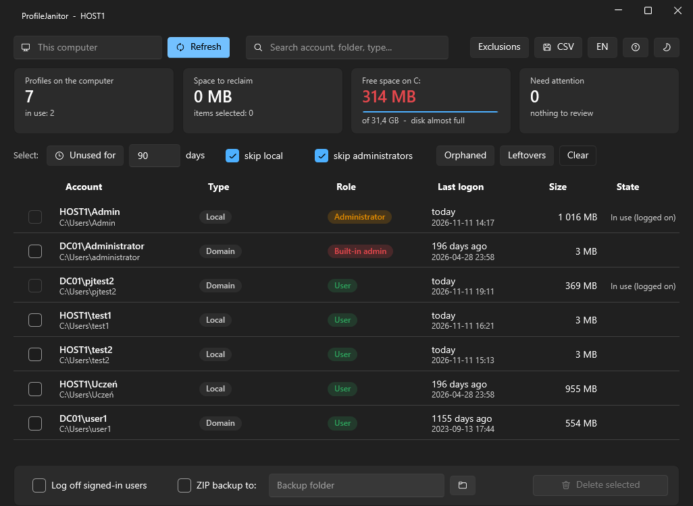
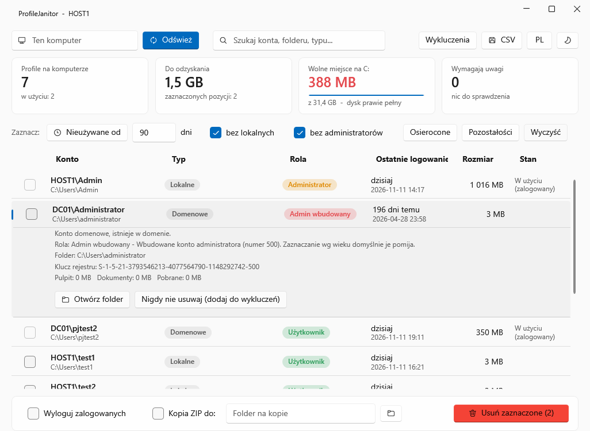

# ProfileJanitor

A small Windows tool for administrators that shows the user profiles on a computer and removes the ones nobody needs:
profiles unused for a long time, orphaned profiles (the account is gone, the profile stayed) and profile leftovers that
cause temporary-profile logons. One `.exe`, nothing to install, Polish and English interface.

> [!WARNING]
> **This program permanently deletes data. Use it at your own risk.**
> A deleted profile cannot be restored: the user's desktop, documents, downloads, application settings and saved
> passwords are gone. The software is provided "as is", without warranty of any kind; the author is not liable for any
> data loss or damage caused by its use (see [LICENSE](LICENSE)). Try it on a test machine first, keep backups, and
> always run automatic mode with `--whatif` before you run it for real.

## What it does

- Lists every user profile with account name, type, role, last logon, size and state.
- **Type**: local, domain, orphaned (account deleted), unverified (domain controller unreachable), or a leftover.
- **Role** on that computer: built-in administrator (red), administrator (orange), standard user (green).
- **Leftovers** it finds and cleans: `.bak` keys in `ProfileList`, profile folders without a registry entry, registry
  entries without a folder.
- Selection helpers: unused for N days, orphaned, leftovers. Nothing is selected at start.
- Optional ZIP backup before deletion. If the backup is incomplete, the profile is **not** deleted.
- Optional logoff of signed-in users (window only, off by default).
- Permanent exclusion list for accounts that must never be touched.
- Works on another computer over the network (WMI + administrative share).
- Command-line mode for scheduled tasks, with a `--whatif` preview.
- Every deletion is written to the Windows event log (Application, source `ProfileJanitor`).

It deletes **profiles only** (the folder and its registry entry, through the same Windows mechanism as
System Properties > User Profiles). It never deletes accounts and never writes to Active Directory.

## Safety rules built in

- Profiles in use cannot be selected unless you explicitly allow logging users off; your own session is never touched.
- Selecting by age skips administrators and local accounts by default, and never picks profiles without a known
  logon date or accounts that could not be verified because the domain controller is unreachable.
- System and service profiles (LocalSystem, IIS application pools, service accounts) are never listed.
- Junctions and symbolic links inside a profile are removed as links; their targets are not followed.
- A deletion that fails is reported as an error, never as success.

## Requirements

- Windows 10 version 1903 or later, or Windows 11 (.NET Framework 4.8 is part of the system), 64-bit.
- Administrator rights.
- For another computer: administrator rights there, WMI and the `C$` share reachable.

## Build

    dotnet build -c Release

The result is `bin\Release\net48\ProfileJanitor.exe`, a single file. In Visual Studio 2022 open `ProfileJanitor.sln`.
No prebuilt binary is published; build it yourself so you know what you run.

## Use

Start `ProfileJanitor.exe`, tick what should go, click **Delete selected** and confirm. Press **F1** for the built-in
help, which explains every label and option.

### Command line

Run from an elevated prompt.

    ProfileJanitor.exe --dump                       list profiles
    ProfileJanitor.exe --auto --days 90 --whatif    show what automatic mode would delete; deletes nothing
    ProfileJanitor.exe --auto --days 90 --orphans --leftovers --backup D:\Backups
    ProfileJanitor.exe --delete S-1-5-21-...-1105   delete one profile by SID
    ProfileJanitor.exe --help                       all parameters

| Parameter | Meaning |
|---|---|
| `--auto --days N` | delete profiles unused for N days; local accounts and administrators are skipped by default |
| `--include-local`, `--include-admins` | include those too |
| `--orphans`, `--leftovers` | also delete orphaned profiles / leftovers |
| `--delete ID...` | delete the given items: SID, `SID.bak` key, or folder path |
| `--backup DIR` | zip each profile to DIR first; no backup, no deletion |
| `--computer NAME` | work on another computer |
| `--whatif` | preview only |
| `--lang pl\|en` | message language |

Exit code: 0 = fine, 1 = some deletions failed, 2 = bad parameters, 3 = fatal error.
Automatic mode does not ask for confirmation and never logs users off.

Permanent exclusions live in `ProfileJanitor.exclude.txt` next to the program: one account name, SID or profile folder
name per line.

## How it was tested

`tests\vm-test.ps1` is an integration test meant for a **disposable virtual machine**. It creates its own local
accounts and fake leftovers, really deletes them with the tool, and finishes by checking that the registry profile
list, the folders in the profiles directory, and the file count and size of every pre-existing profile are unchanged.
It covers the command line, refusals, leftovers, orphaned profiles, long paths, locked files, backups that do not fit,
and the window logic (through an in-process `--uitest` mode). `--screenshot file.png` renders the window to an image.

Domain behaviour was checked by hand against a test domain: existing accounts, an account deleted from Active
Directory, and running as a local administrator without domain credentials.

**Not tested:** logging off a real desktop session, a real second computer in remote mode (only loopback),
Windows 11, Azure AD / Entra ID accounts, FSLogix or roaming profiles, domain controllers as the target.

## Known limits

- One computer at a time; no alternate credentials for remote work.
- Exclusions are exact names, no wildcards.
- A domain account's role comes from its last logon on that computer when the domain cannot be queried.
- The signing script produces a self-signed certificate, which SmartScreen does not trust.

## Po polsku

ProfileJanitor pokazuje profile użytkowników na komputerze z Windows i usuwa te niepotrzebne: dawno nieużywane,
osierocone (konto usunięto, profil został) oraz pozostałości po profilach. Interfejs jest po polsku i po angielsku,
a pełny opis znajduje się w pomocy programu pod klawiszem **F1**.

**Program nieodwracalnie usuwa dane. Używasz go na własną odpowiedzialność.** Oprogramowanie jest udostępniane
w stanie „takim, jakie jest", bez żadnej gwarancji; autor nie odpowiada za utratę danych ani inne szkody wynikłe
z jego użycia. Najpierw wypróbuj je na maszynie testowej, rób kopie zapasowe, a tryb automatyczny zawsze zaczynaj
od `--whatif`.

## License

[MIT](LICENSE). ProfileJanitor embeds third-party components; their licenses are in
[THIRD-PARTY-NOTICES.txt](THIRD-PARTY-NOTICES.txt).
